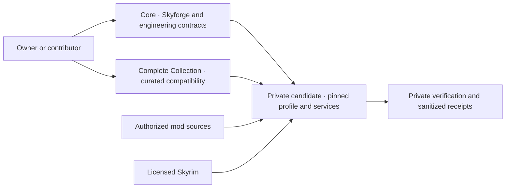

# System architecture

Sauriil’s Skyrim Awakened aims for a persistent, lore-grounded Skyrim in which distinct NPCs have their own experiences and pursue eligible activities even without a player turn. Its original October inception transcript is incompletely recovered. Contemporary decisions, later owner amendments and reconstructed requirements have distinct provenance in the owner's private records. The [roadmap issues](https://github.com/jikovec/sauriils-skyrim-awakened-core/issues) track operational work. The [decision register](decisions.md) records durable engineering decisions.

| Status | What exists or is proposed |
| --- | --- |
| Public implementation | Skyforge Rust source, Cargo dependency lock, source-only verification and synthetic interface fixtures. The [Core scope](../CORE-SCOPE.md) describes the preview inventory. |
| Private implementation | Isolated Stock Game, Proton/MO2 configuration and CHIM/AIAgent + local inference and speech services. Some NPC context, lore and persistence hooks have implementation or candidate evidence. Inspect the released bytes and the owning evidence before making any runtime claim. |
| Target | [Runtime architecture](runtime.md), [data and interfaces](data.md), and [resource management and diagnostics](operations.md). Target policies and schemas do not establish adoption by any runtime producer. |
| Transitional | Keep existing CHIM paths working. Introduce versioned adapters at observed event, SQL, inference, speech and action boundaries with compatibility fixtures and isolated qualification. Apply migrations and runtime changes only under separate authorization. |
| Experimental | Native instrumentation, optional speech and inference variants, readable mind projections and more elaborate offscreen simulation. Promote any variant only against measured compatibility and acceptance. |
| Deferred or declined | Generated allegiance changes outside authored outcomes require their own decision. Per-NPC model residency, a second authoritative mind store, and unrestricted generated effects conflict with the adopted architecture. |

[Core](../CORE-SCOPE.md) owns Skyforge, native integration, local AI and CHIM integration, minds, data, scheduling, speech, supported actions and shared engineering contracts. The [Complete Collection](https://github.com/jikovec/sauriils-skyrim-awakened) owns reference manifests, mod/load-order and quest compatibility, gameplay and visual configuration, collection qualification and distribution metadata. Its integration documentation points back to this architecture.

The owner workspace owns installed Skyrim, MO2 and Proton state, downloads, original recordings and cloned voices, models, saves, databases, credentials, private diagnostic records and uncleared derivatives. Public projects can reference eligible designs and sources. They receive private-workspace source only through the [source-promotion workflow](../engineering/promotion.md). The historical public v0.0.3 reference preview and later local configurations describe different runtime identities. See [development and release evidence](../engineering/development.md) for their version and qualification boundaries.
