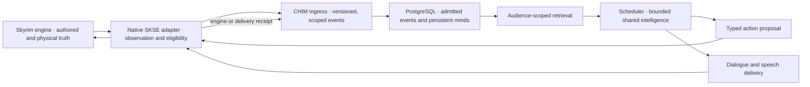

# Living-world runtime target

**Engine and native integration.** Capture on supported engine callbacks or safe snapshots under the game-thread ownership rules. Carry the effective actor reference, base/source plugin identity, playthrough, session/load epoch and observation validity. Keep locations and loaded cells, quest and scene state, factions and engine relationships, equipment and inventory, combat, perception, dialogue and clock changes attributable to an observed boundary. Mark unavailable fields and distinguish stale observation, inferred state and player claim. Validate sequence, lifetime and capabilities before access or effects. Load/unload, restart and replacement invalidate transient handles. Never write quest stage, progression or inventory from model text.

**Services and inference.** The native CHIM/AIAgent client exchanges requests with the owner-side CHIM service. PostgreSQL records authoritative cross-session state, and existing local inference, STT and TTS endpoints serve bounded work. Keep game handles out of PHP/SQL/model request schemas. Deterministic rules decide immediate safety, authored eligibility and mechanics. Lightweight contextual inference can rank eligible choices. Shared conversation inference handles richer dialogue. Escalate larger reasoning work only for a demonstrable benefit and under a measured deadline. Use a small typed adapter for data, deadline, cancellation and response provenance where concrete implementations need one. Preserve working CHIM paths while qualifying each new adapter.

**Individual minds.** Persistent identity scopes authored persona, faction/culture, personally acquired knowledge, beliefs, memories, relationships, needs, goals, intentions, commitments, affect and personal history. State includes provenance, chronology, version and visibility. Transient prompts, model output and pending context belong to a bounded request and expire with it. Intentions can persist without assuming an action was admitted. Restore from the matching save and SQL checkpoint and resolve uncertain identity before writing.

| Simulation tier | Activation and work |
| --- | --- |
| Player is interacting | Admit timely turn-taking and game-critical proposals against current scene and actor state. Preempt elective inference. Cancel on interruption, focus/load change as appropriate, or stale target. |
| Nearby and loaded | React to eligible events and NPC opportunities with bounded light updates. Validate current engine state immediately before proposing and executing effects. |
| Same settlement | Coalesce events, maintain eligible abstract needs and goals, defer rich requests until relevant. |
| Distant | Schedule sparse game-clock updates or dependencies for independently motivated routines. Record abstractions with explicit provenance. |
| Unloaded or dormant | Retain identity and durable state. Defer evaluation with bounded catch-up. Reconcile against newly observed world state on re-entry. |

Tier changes preserve chronology and pending obligations. Budget catch-up and discard expired work. Physical effects require loaded, supported engine execution and a receipt. Authored quest scenes and ownership have precedence. A curated compatibility adapter checks live scene/quest/alias eligibility and preserves original dialogue, quest rewards and package ownership unless a separately verified authored integration owns an explicit change.

**Actions.** A decision can yield an intention, and an intention can produce a typed proposal. The owning adapter checks supported capability/version, actor and target, scene/quest constraints, authorization, deadlines and idempotency before accepting. Accepted and in-progress states describe execution only. Completion requires engine evidence scoped to the same request, playthrough and actor. A terminal failure or cancellation cannot become completion after late output. Record reconciliation for crashes and possible partial effects before retrying.

**Speech.** Correlate VAD/recording, segment, transcript revision, turn, selected line, synthesis or original voice asset, each ordered utterance and its playback receipt. Keep timestamps in the same declared clock domain or record the clock relationship. Preserve authored voice and scene priority. Subtitles and lip sync use the admitted utterance and timing of actual playback. Interrupt on owner/player or scene transitions where supported, cancel queued segments, and record what portion actually played and could be heard by the eligible audience. Transcript corrections stay linked to earlier revisions. Store player audio and dialogue only under explicit local retention policy. Current speech and semantic acceptance are resolved through their own Issues and runtime checks.
